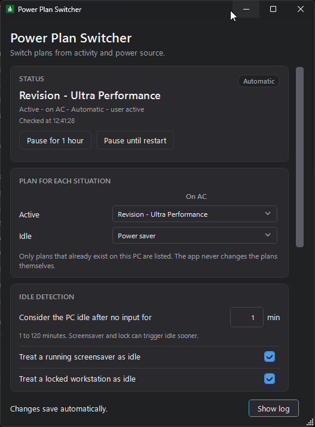
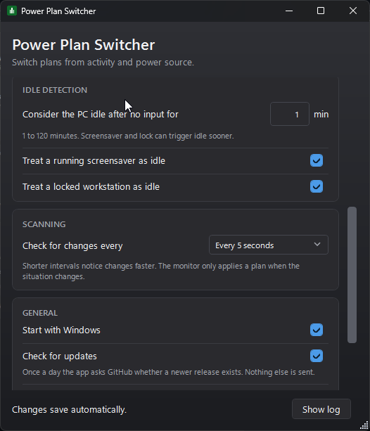
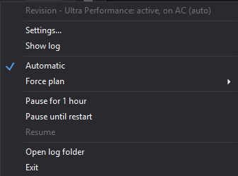

# Power Plan Switcher

A Windows tray app that switches the active power plan when you go idle, come
back, or unplug the charger.

Version 0.3.0.

## Download

Take `PowerPlanSwitcher.exe` from [Releases](../../releases). Install the
[.NET 8 Desktop Runtime](https://dotnet.microsoft.com/download/dotnet/8.0) for
Windows x64 first, then run the exe. It stays in the notification area.

## Screenshots

<p align="center">
  
  
</p>
<p align="center">
  
</p>

## What it does

- Watches input idle time (`GetLastInputInfo`), the screensaver
  (`SystemParametersInfo`), lock and unlock (`SystemEvents.SessionSwitch`), and
  the power source (`GetSystemPowerStatus`).
- Maps the four combinations of activity and power source to existing plans. By
  default, active on AC uses Balanced and the other three use Power saver.
- Applies the rules in Automatic mode. Pause stops switching for an hour or until
  the app restarts.
- Force plan pins any plan that exists on this PC, including custom plans, for
  the current session. It does not change the saved rules.
- Reads the active plan with `PowerGetActiveScheme`, switches with
  `PowerSetActiveScheme`, then reads it back to confirm. A missing plan or an
  unset cell leaves the current plan alone.
- Leaves the plan alone when Windows cannot report the power source. It does not
  guess AC.
- Shows the current mode, the last check time, recent switches, and any problem
  in the settings window. A failure is not left to a tray balloon alone.
- Keeps one log file per day and shows them in a log pane.
- Checks GitHub once a day for a newer release and can update itself in one
  click. That is the app's only network call, and it can be turned off under
  General.

## Requirements

- Windows 10 or 11 on x64.
- [.NET 8 Desktop Runtime](https://dotnet.microsoft.com/download/dotnet/8.0) to
  run the release build. Newer desktop runtimes work too.
- To build: .NET SDK 9.0.200 or newer. The solution uses `powerplan.slnx`, and
  the .NET 8 SDK cannot read that format. .NET 10 works too.

## Build from source

```powershell
dotnet build powerplan.slnx
dotnet test powerplan.slnx
dotnet publish src/PowerPlanSwitcher/PowerPlanSwitcher.csproj -c Release
```

Publish writes one exe. Add `-p:SelfContained=true` for a portable build that
bundles the runtime.

`global.json` requests SDK 9.0.200 and rolls forward, so a newer installed SDK
also works.

## Settings

- Start with Windows is off on a new install. Turn it on under General.
- At startup the app lines the Start with Windows registry entry up with this
  setting: it rewrites the entry if the exe moved and removes a leftover entry
  when the setting is off.
- Changes save as soon as you make them.
- Show log opens a pane beside the settings. It lists one file per day, refreshes
  the selected file while Live is on, and has buttons to open the file or folder
  and copy the text.
- The pane follows the newest line unless you scroll up.
- Check for updates is on by default. When a newer release is out, the
  status card and the tray menu offer Update. The download is checked against
  the published checksum before anything is replaced, then the app swaps
  itself and restarts.
- Copy diagnostics puts the version, OS, runtime, plan list, settings and log
  paths, the last problem, and 40 log lines on the clipboard. Nothing leaves the
  PC.
- A plan that is no longer installed shows as Missing plan. Pick another plan or
  Not set.
- Force disables the rules grid until you press Return to automatic.
- The tray menu has Settings..., Show log, Automatic, Force plan, Pause for
  1 hour, Pause until restart, Resume, Open log folder, and Exit.

## Configuration

Settings live in `%LocalAppData%\PowerPlanSwitcher\settings.json`. Writes go
through a temp file and `File.Replace`, so a crash does not leave a half-written
file.

```json
{
  "version": 1,
  "rules": {
    "acActive": "381b4222-f694-41f0-9685-ff5bb260df2e",
    "batteryActive": "a1841308-3541-4fab-bc81-f71556f20b4a",
    "acIdle": "a1841308-3541-4fab-bc81-f71556f20b4a",
    "batteryIdle": "a1841308-3541-4fab-bc81-f71556f20b4a"
  },
  "idle": { "inputTimeoutMinutes": 5, "onScreensaver": true, "onLock": true },
  "scanIntervalSeconds": 2,
  "startWithWindows": false,
  "checkForUpdates": true
}
```

The app also accepts the nested shape (`rules.active.ac`, `rules.idle.battery`).
Nested values win when a file contains both shapes. A bad GUID marks that cell
unset and reports it. A rule cell with a number where a GUID belongs is unset
too. A wrong JSON type on a scalar field resets that field to its default and
reports the field; the rest of the file is kept. Fields the app does not know
survive a save at the top level and in the `rules` and `idle` sections. Idle time
clamps to 1 to 120 minutes and the scan interval to 1 to 60 seconds.
`checkForUpdates` turns the daily GitHub check on or off. The last check time
lives in `update.json` next to the settings file.

The log is one file per day at
`%LocalAppData%\PowerPlanSwitcher\logs\app-YYYY-MM-DD.log`. The app keeps 14
days. A day's file rolls at 5 MB and keeps one `.1` part. The old `app.log` is no
longer written.

## Manual checklist

These tests need Windows 10 or 11 with both AC and battery available.

1. Leave the PC idle past the timeout. The plan changes to Power saver.
2. Move the mouse. It changes back within the scan interval.
3. Start the screensaver. The change is immediate.
4. Press Win+L, then unlock. The plan changes in both directions.
5. Unplug and replug the charger. The plan follows the battery and AC cells.
6. Pick a plan from Force, including a custom plan, then press Return to
   automatic. The grid is disabled while the plan is forced.
7. Pause for 1 hour, then change the plan in Windows Settings. The app leaves it
   alone until you press Resume.
8. Delete a plan the app points at. The cell shows Missing plan and the status
   card shows the warning. Pick another plan or Not set.
9. Toggle Start with Windows. Check the Run key under HKCU.
10. Launch the app twice. One tray icon appears and the first copy shows its
    settings window.
11. Corrupt `settings.json`. The app starts with defaults and writes
    `settings.json.bad`.
12. Put a string in `scanIntervalSeconds`. The other settings load, the interval
    uses its default, and the status card reports the field.
13. Open the log pane. It lists the daily files. Press Refresh after midnight to
    see the new day. Live updates the selected file.
14. Copy diagnostics and paste it into a text file. It includes the version and
    the last 40 log lines.
15. On a desktop with no battery, the On battery column is hidden.
16. Launch with the latest release already published (or temporarily point the
    check at a repo with a newer tag). The tray menu shows Update to X and the
    settings card offers Install update. Click it: the app downloads, swaps,
    and restarts on the new version.
17. Turn Check for updates off, restart, and watch the log: no update check
    line appears. Turn it back on and the next start checks again.

## Uninstall

1. Exit from the tray menu.
2. Delete the `PowerPlanSwitcher` value under
   `HKCU\Software\Microsoft\Windows\CurrentVersion\Run` if it is present.
3. Delete `%LocalAppData%\PowerPlanSwitcher`.

## Privacy

The app has no telemetry and no account. Its only network contact is a daily
check for a newer release on GitHub, plus the download when you choose to
update. Turn it off under General. Settings and logs stay under
`%LocalAppData%\PowerPlanSwitcher`.

## License

GPL-3.0, see [LICENSE](LICENSE). Fork of PowerPlanManager.
